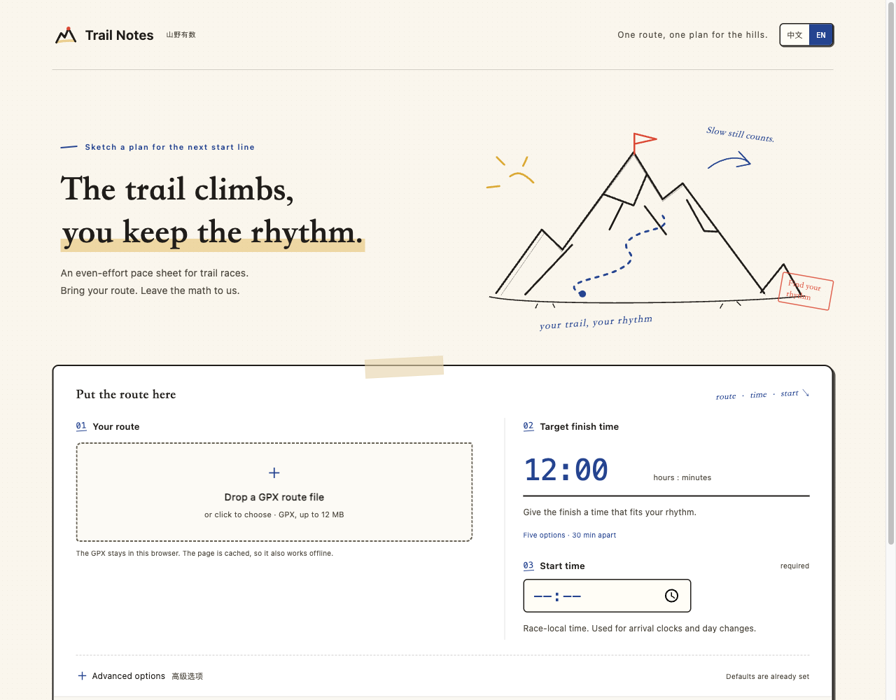
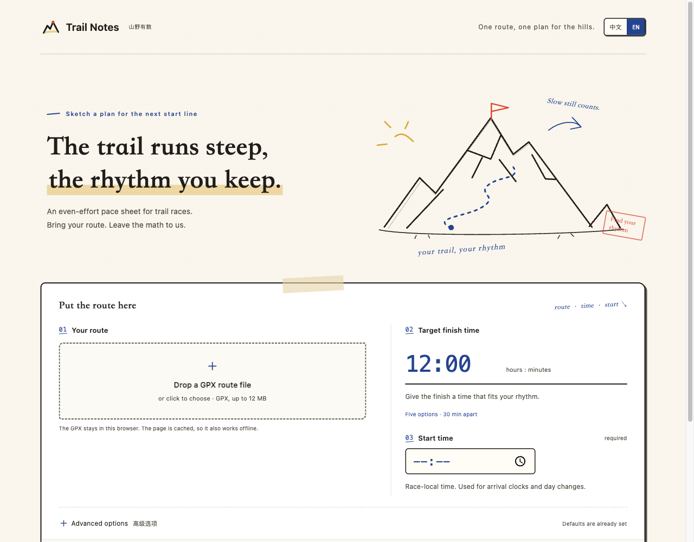
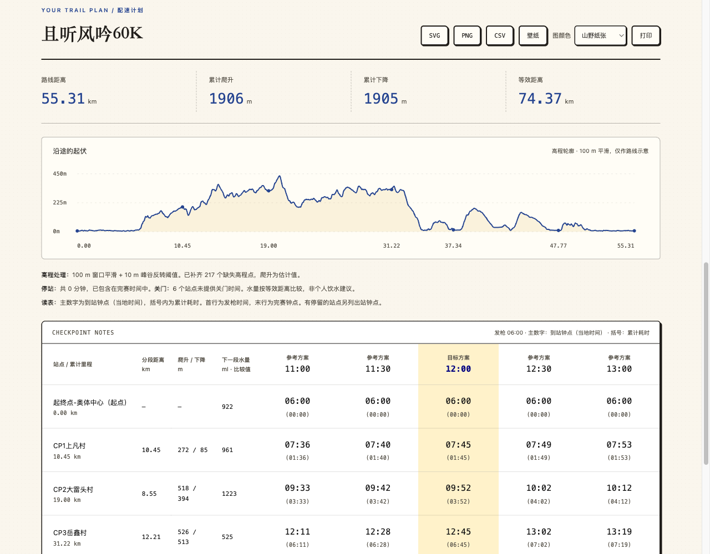
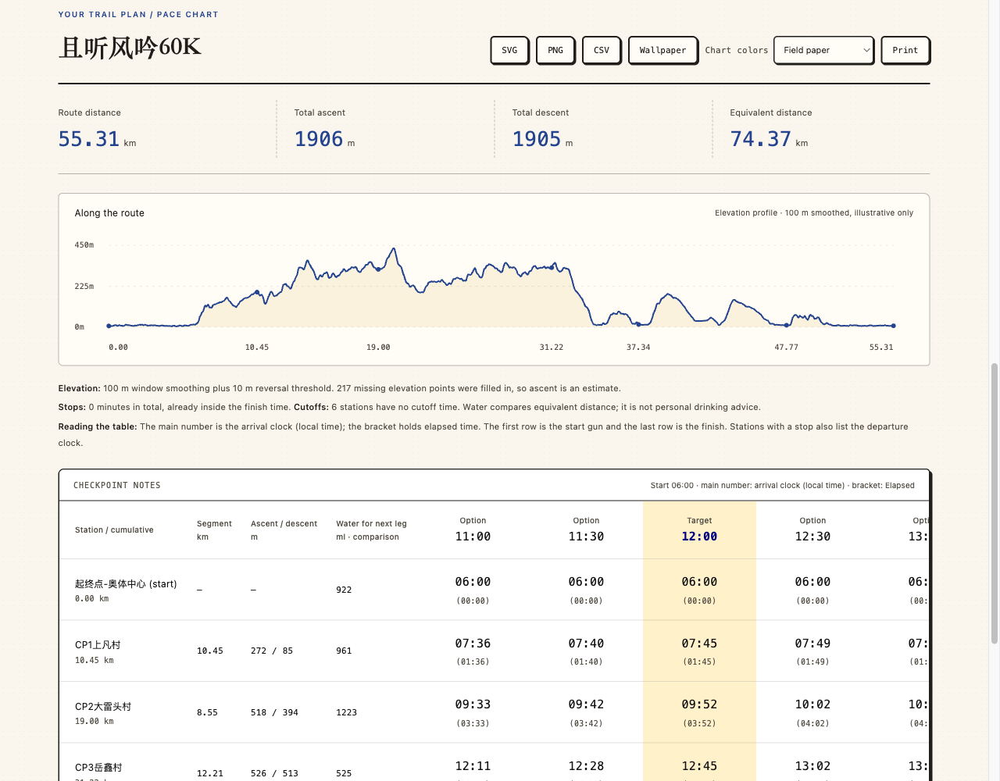
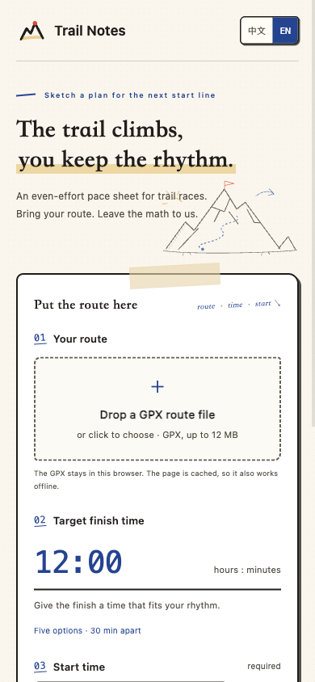
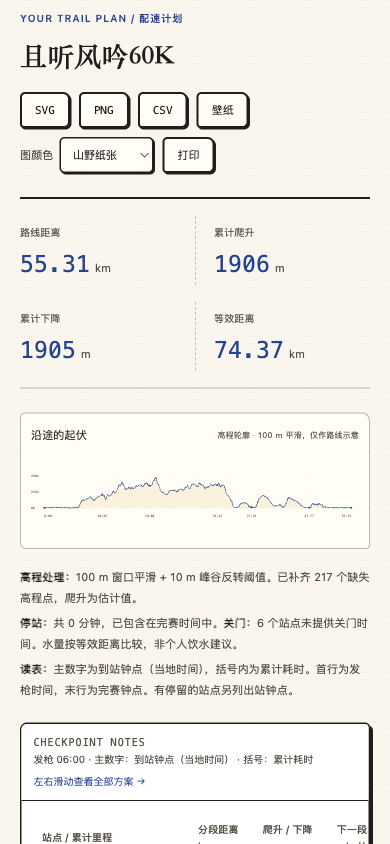
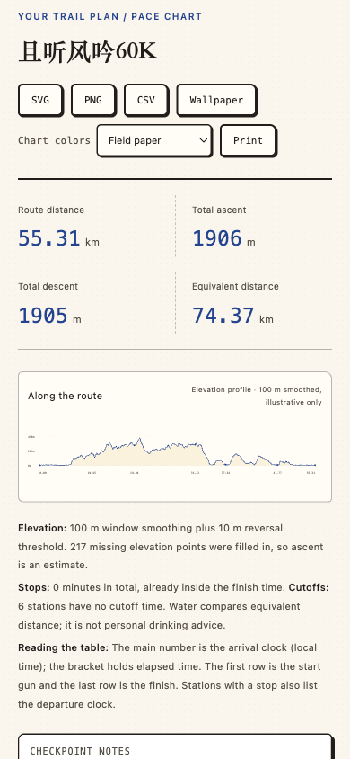

已按简洁原则编写。

# 多语言改造验收记录

- 代码提交：`c08db3b`，PR #2 合并提交 `e7234e8`
- 线上地址：<https://trail-running-pacer-sheet.million-ai.com/?lang=en>
- 测试数据：`且听风吟60K.gpx`，55.31 km，爬升约 1906 m，目标 12:00，发枪 06:00
- 自动测试：`make test` 12 项 Python + 55 项 JavaScript 全部通过；`make check` 通过
- 完整对比报告（并排、差异热图、4x 放大）：`/tmp/reports/trail-running-dev/report.md`

## 首屏中英对照

同一版式下品牌、标题、字段标签、提示和按钮全部切换；右上角语言切换显示选中态。

英文标语已在第二轮改为押韵句：`The trail runs steep,` / `the rhythm you keep.`（韵脚 steep / keep），中文 `山路有起伏，奔跑有节奏。` 未改。320、390、768、1024、1280、1440 px 下两行均各占一行，无折行与溢出。

## 结果表格中英对照

表头、图例、说明段落、起点终点标注全部跟随语言。时间与数字不变。切换语言不重新生成，已填写的停留时间与经过位置保留。

## 手机 390 × 844

两种语言都没有横向溢出（`scrollWidth - innerWidth = 0`），宽表格在独立区域横向滚动。

## 线上验收

线上环境：上传 GPX、填写发枪时间、生成表格、下载英文 SVG 均成功。下载文件 `且听风吟60K-pace-sheet.svg` 表头与图例为英文，不含中文界面文案。

## 其他实测项

| 项目 | 结果 |
| --- | --- |
| 切换语言后状态提示 | 跟随切换，例如「路线已就绪」→ `Route ready` |
| 未填发枪时间的报错 | `Enter the start time before generating, for example 06:00. Use race-local time.` |
| 断网刷新后切换语言 | 成功，`i18n.js` 已在 Service Worker 缓存清单 |
| `?lang=en` 直接访问 | 首屏为英文，`<html lang="en">`，标题与 meta 描述为英文 |
| 刷新后语言保持 | 保持，地址栏带 `?lang=`，`localStorage` 记住选择 |
| 站点名 | 保持 GPX 原始名称；起点/终点由程序标注并翻译 |
| 导出 CSV | 字段名与站点名不随语言变化 |

## 未覆盖

- iPhone 真机原生文件选择器的中英文界面。
- 繁体中文（zh-Hant）未提供独立词典，按简体处理。
- 浏览器语言为中文、英文以外的语言时回退英文，未逐语言验证。

已遵循简洁原则。
